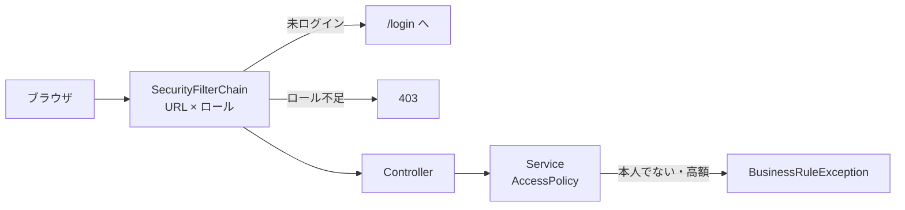

::: haru
先輩、承認くんって今「社員ID=1 の人」として全部動いてるんすよね。僕が部長の申請を承認し放題っす。
:::

::: sensei
それを今日終わらせる。ログインを付けて、「誰が」をセッションから取る。ついでに URL とボタンをロールで締める。
:::

::: haru
ボタンを隠せば終わりっすね!
:::

::: sensei
……それが今日一番の地雷だ。最後まで聞いて。
:::

## 今回作るもの

| ファイル(`com.example.approval` 配下) | 役割 |
|---|---|
| `pom.xml` | Security と Thymeleaf 連携を追加 |
| `domain/Employee.java` | `password`(BCrypt のハッシュ)を追加 |
| `config/SecurityConfig.java` | URL ルール・ログイン・BCrypt |
| `config/LoginUser.java` | ログイン中の社員(UserDetails) |
| `config/LoginUserDetailsService.java` | メールアドレスで社員を探す |
| `web/LoginController.java` + `templates/login.html` | ログイン画面 |
| `service/AccessPolicy.java` | 申請ごとの権限判定(演習1) |

ログイン ID はメールアドレス、パスワードは `Employee` に足す `password` 列に **BCrypt のハッシュ** で持ちます。

## 設計:関所は2段構え

**認証**(authentication)は「あなたは誰か」を確かめること、**認可**(authorization)は「その人がこれをしてよいか」を決めることです。承認くんの認可は2段にします。



| 段 | 見るもの | 例 |
|---|---|---|
| URL(Filter) | ロールだけ | `/approvals/**` は承認者以上 |
| Service | 申請の中身 | 自分の申請は承認不可、10万円以上は ADMIN |

「この申請の申請者は誰か」「金額はいくらか」は URL からは分かりません。業務ルール1〜3は **申請を読み込んだ後の Service でしか判定できない** のです。

## STS での実装

### 依存と URL ルール

`pom.xml` に `spring-boot-starter-security` と `thymeleaf-extras-springsecurity6` を足します(バージョンは Spring Boot が管理するので書かない)。

```java
// config/SecurityConfig.java
@Configuration
public class SecurityConfig {

  @Bean
  SecurityFilterChain filterChain(HttpSecurity http)
      throws Exception {
    http
      .authorizeHttpRequests(auth -> auth
        .requestMatchers("/login", "/error").permitAll()
        .requestMatchers(PathRequest.toStaticResources()
            .atCommonLocations()).permitAll()
        .requestMatchers("/approvals/**",
            "/requests/search",
            "/requests/*/approve", "/requests/*/return",
            "/api/**")
          .hasAnyRole("APPROVER", "ADMIN")
        .anyRequest().authenticated())
      .formLogin(form -> form
        .loginPage("/login")
        .defaultSuccessUrl("/requests", true)
        .permitAll())
      .logout(logout -> logout
        .logoutSuccessUrl("/login?logout"));
    return http.build();
  }

  @Bean
  PasswordEncoder passwordEncoder() {
    return new BCryptPasswordEncoder();
  }
}
```

- ルールは **上から順に、最初に一致したもの** で決まります。細かい URL を上に、`anyRequest()` を最後に
- `/requests/*/approve` の `*` は「1階層ぶん」。承認・差戻しは HTTP メソッドで絞らず URL で締めます(後から誰かが GET の承認を足しても穴にならない)
- `/error` を開けておかないと、未ログインでエラーになったときにエラー画面ではなくログイン画面へ飛ばされます
- `hasAnyRole("ADMIN")` は権限 `ROLE_ADMIN` を探します。`ROLE_` は自動で付きます

### ログイン中の社員:UserDetails

```java
// config/LoginUser.java
public record LoginUser(Long id, String name,
        String email, String password, Role role)
        implements UserDetails {

    @Override
    public Collection<? extends GrantedAuthority>
            getAuthorities() {
        return List.of(new SimpleGrantedAuthority(
                "ROLE_" + role.name()));
    }
    @Override public String getUsername() { return email; }
    @Override
    public String getPassword() { return password; }

    @Override public String toString() { // ハッシュを出さない
        return "LoginUser[id=" + id + ", role=" + role + "]";
    }
}
```

```java
// config/LoginUserDetailsService.java
@Service
public class LoginUserDetailsService
        implements UserDetailsService {
    private final EmployeeRepository employees;
    // コンストラクタは省略

    @Override
    public UserDetails loadUserByUsername(String email) {
        return employees.findByEmail(email)
            .map(e -> new LoginUser(e.getId(), e.getName(),
                e.getEmail(), e.getPassword(), e.getRole()))
            .orElseThrow(() ->
                new UsernameNotFoundException(email));
    }
}
```

`Employee` エンティティそのものをセッションに入れないのは、LAZY の関連や古いデータを抱えたまま何時間も残るからです。ログイン中に要る **ID・名前・ロールだけの小さな不変オブジェクト** にします。

BCrypt のハッシュは `$2a$10$` + ソルト22文字 + ハッシュ31文字の60文字です。`10` は **コスト**(2¹⁰ 回の繰り返し)で、ソルトもハッシュ値の中に入っているので、照合は `passwordEncoder.matches(入力, 保存値)` だけで済みます。

### 固定の社員ID を @AuthenticationPrincipal に置き換える

capstone-apply では仮に「社員ID=1」で動かしていました。ログイン中の `LoginUser` は引数で受け取れます。

```java
// web 配下の申請画面の Controller
// 変更前: Long employeeId = 1L;
@PostMapping("/requests/{id}/approve")
public String approve(@PathVariable Long id,
        @RequestParam(required = false) String comment,
        @AuthenticationPrincipal LoginUser user) {
    approvalService.approve(id, user.id(), comment);
    return "redirect:/requests/" + id;
}
```

`approvalService` の引数の形は capstone-approve で作ったものに合わせてください。**画面から社員ID を hidden で送らせてはいけません**。hidden の値はブラウザの開発者ツールで書き換えられます。「誰が」は必ずサーバー側のセッションから取ります。

### ボタンをロールで出し分ける

```html
<html xmlns:th="http://www.thymeleaf.org"
  xmlns:sec="http://www.thymeleaf.org/extras/spring-security">
<span th:text="${#authentication.principal.name}">名前</span>
<a sec:authorize="hasAnyRole('APPROVER','ADMIN')"
   th:href="@{/approvals}">承認待ち一覧</a>
<form th:action="@{/logout}" method="post">
  <button>ログアウト</button>
</form>
```

`th:action` を使ったフォームには、Thymeleaf が **CSRF トークン** の hidden を自動で入れます。

## 画面で隠すだけではダメな理由

ボタンを隠しても、`POST /requests/5/approve` は curl でも開発者ツールでも送れます。しかも URL ルールはロールしか見ないので、**承認者が自分の申請を承認する** リクエストは Filter を素通りします。

だから業務ルール1〜3は Service で必ず判定します。演習1の `AccessPolicy` は、その判定を1か所に集めたクラスです。

```java
// service/ApprovalService.java の承認処理の先頭
Decision d = accessPolicy.check(
        actorId, actor.getRole(), Operation.APPROVE, req);
if (!d.allowed()) {
    throw new BusinessRuleException(d.reason());
}
```

画面の出し分けは「押せないボタンを見せない親切」、Service のチェックは「規則そのもの」。両方が同じ `AccessPolicy` を使えば、画面とサーバーで判定がずれません。

::: sensei
画面だけで守ったつもりのシステムは、脆弱性診断で一発で見つかる。「隠す」は UX、「拒否する」はセキュリティ。別物だよ。
:::

## 動作確認

1. 起動して `/requests` を開く → `/login` に飛ばされる
2. 申請者でログイン → 自分の申請一覧。「承認待ち一覧」リンクが出ない
3. そのまま `/approvals` を URL で開く → 403
4. 承認者でログイン → 自分の申請の詳細で、承認ボタンを押しても(または URL を直接 POST しても)`BusinessRuleException` のメッセージ
5. ログアウト → `/login?logout` に戻る

## よくあるミス

::: warn hasRole("ROLE_ADMIN") と書く
起動時に `ROLE_ADMIN should not start with ROLE_ since ROLE_ is automatically prepended when using hasAnyRole` で落ちます(`hasRole` も中で `hasAnyRole` を使うので、メッセージはこうなる)。`hasRole` には `ROLE_` を付けません。付けて書きたいなら `hasAuthority("ROLE_ADMIN")` です。
:::

::: warn @AuthenticationPrincipal が null
`UserDetailsService` が `LoginUser` 以外(Spring の `User` など)を返していると、型が合わず **黙って null** が入ります。返す型と引数の型を揃えます。
:::

::: warn 手書きの form で 403
`<form action="/requests/5/approve" method="post">` のように `th:action` を使わないと CSRF トークンが入らず、POST が 403 になります。ログアウトも POST です(`<a href="/logout">` ではログアウトできません)。
:::

::: point まとめ
- URL(ロール)と Service(申請の中身)の2段で守る。業務ルール1〜3は Service で必ず判定
- `UserDetailsService` で `Employee` → 小さな `LoginUser` に詰め替え、パスワードは BCrypt
- 「誰が」は `@AuthenticationPrincipal` でセッションから取る。画面から送らせない
- `sec:authorize` のボタン出し分けは親切であって、守りではない
:::
