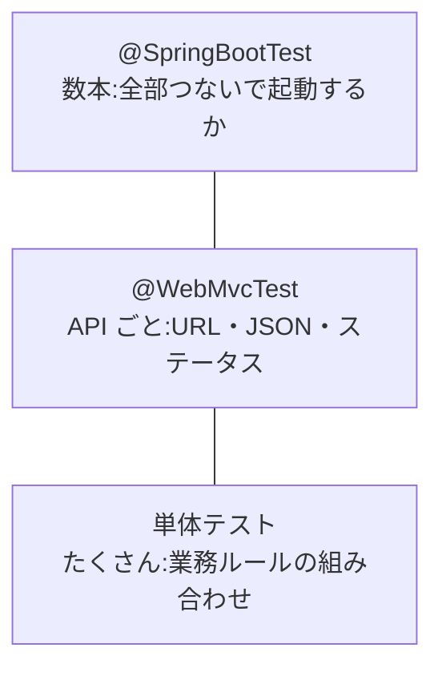

::: haru
先輩、「スマホから承認したい」って要望が来てます! 画面をもう1セット作るんすか?
:::

::: sensei
画面は作らない。JSON を返す **REST API** を足すだけだ。ただし API は外との「約束」。約束が守られているかを、今日はテストで固める。
:::

## 今回作るもの

| メソッド・URL | 成功 | 失敗 |
|---|---|---|
| GET /api/requests?status= | 200 一覧 | 400(status が不正) |
| GET /api/requests/{id} | 200 詳細 | 404 |
| POST /api/requests/{id}/approve | 200 承認後の詳細 | 404 / 409 / 403 |

★が今回作るファイルです。

```text
src/main/java/com/example/approval
├─ domain/RequestNotFoundException.java ★
├─ service/RequestQueryService.java ★
└─ web/api
    ├─ RequestSummary.java ★
    ├─ RequestDetail.java ★
    └─ RequestApiController.java ★
src/test/java/com/example/approval
├─ web/api/RequestApiControllerTest.java ★
├─ service/ApprovalServiceTest.java ★
└─ ApprovalAppApplicationTests.java(既存)
```

## 設計の考え方

### エンティティではなく record の DTO を返す

エンティティをそのまま返すと、Jackson が関連をたどって `applicant` の **email やパスワードのハッシュまで JSON に出します**。列を足すたびに API の形も勝手に変わります。そこで API 専用の型 **DTO**(Data Transfer Object:受け渡し専用のデータの入れ物)を record で作ります。

```java
package com.example.approval.web.api;

public record RequestSummary(
        Long id, String title, RequestType type,
        Integer amount, RequestStatus status,
        String applicantName,
        LocalDateTime submittedAt) {

    public static RequestSummary from(ApprovalRequest r) {
        return new RequestSummary(r.getId(),
                r.getTitle(), r.getType(), r.getAmount(),
                r.getStatus(), r.getApplicant().getName(),
                r.getSubmittedAt());
    }
}
```

`RequestDetail` も同じ形で、`reason`・`approverName`(未承認なら `null`)・`comment`・`createdAt`・`decidedAt` を足します。一覧は軽く詳細は全部。**用途ごとに DTO を分ける** のが現場流です。

### ステータスコードは「何がダメか」で決める

| コード | 意味 | 承認くんでは |
|---|---|---|
| 400 | リクエストの形が変 | Spring 標準 |
| 403 | API を使う権限がない | Spring Security |
| 404 | その申請がない | RequestNotFoundException |
| 409 | 今の状態ではできない | BusinessRuleException |

409 Conflict は「リソースの現在の状態と衝突した」という意味で、承認済の申請をもう一度承認するのが典型です。承認くんでは、業務ルール違反(自分の申請・10万円以上など)はすべて `BusinessRuleException` → 409、ロールでの門前払いは Security → 403、と線を引きます。

::: sensei
自分の申請の承認を 403 にする流派もある。大事なのは、チームで決めて全 API で揃えることだ。
:::

## STS での実装

「ない」は業務ルール違反ではないので、別の例外にします。

```java
package com.example.approval.domain;

public class RequestNotFoundException
        extends RuntimeException {
    public RequestNotFoundException(Long id) {
        super("申請(ID=" + id + ")が見つかりません");
    }
}
```

読み取り専用の Service を `service` パッケージに作ります。

```java
@Service
@Transactional(readOnly = true)
public class RequestQueryService {
    private final ApprovalRequestRepository repo;

    public RequestQueryService(
            ApprovalRequestRepository repo) {
        this.repo = repo;
    }

    public List<ApprovalRequest> findByStatus(
            RequestStatus status) {
        return status == null
                ? repo.findAll(Sort.by("id"))
                : repo
                    .findByStatusOrderBySubmittedAtAsc(status);
    }

    public ApprovalRequest get(Long id) {
        return repo.findById(id).orElseThrow(
                () -> new RequestNotFoundException(id));
    }
}
```

Controller です。承認は capstone-approve の `ApprovalService.approve(申請ID, 社員ID, コメント)` に任せ、「誰が」は capstone-security の `LoginUser` から取ります。

```java
@RestController
@RequestMapping("/api/requests")
public class RequestApiController {
    private final RequestQueryService queryService;
    private final ApprovalService approvalService;
    // コンストラクタは省略

    @GetMapping
    public List<RequestSummary> list(
            @RequestParam(required = false)
            RequestStatus status) {
        return queryService.findByStatus(status).stream()
                .map(RequestSummary::from).toList();
    }

    @GetMapping("/{id}")
    public RequestDetail detail(@PathVariable Long id) {
        return RequestDetail.from(queryService.get(id));
    }

    @PostMapping("/{id}/approve")
    public RequestDetail approve(@PathVariable Long id,
            @RequestParam(required = false) String comment,
            @AuthenticationPrincipal LoginUser user) {
        return RequestDetail.from(approvalService
                .approve(id, user.id(), comment));
    }

    @ExceptionHandler(BusinessRuleException.class)
    public ProblemDetail onRule(BusinessRuleException e) {
        ProblemDetail pd = ProblemDetail.forStatusAndDetail(
                HttpStatus.CONFLICT, e.getMessage());
        pd.setTitle("業務ルール違反");
        return pd;
    }

    @ExceptionHandler(RequestNotFoundException.class)
    public ProblemDetail onNotFound(
            RequestNotFoundException e) {
        ProblemDetail pd = ProblemDetail.forStatusAndDetail(
                HttpStatus.NOT_FOUND, e.getMessage());
        pd.setTitle("申請が見つかりません");
        return pd;
    }
}
```

`ProblemDetail` は RFC 9457 のエラー形式で、`Content-Type: application/problem+json` になります。本文は `{"title":"業務ルール違反","status":409,"detail":"承認済の申請は変更できません",...}` です。

## Controller のテスト:@WebMvcTest + @MockitoBean

`@WebMvcTest` は Web 層の Bean だけで小さく起動し、Service は `@MockitoBean`(Mockito の偽物)で差し替えます。Security のフィルタも載るので、本物の URL ルールで 403 まで確かめられます。`LoginUser` が要る操作は `.with(user(...))` で渡します。

```java
@WebMvcTest(RequestApiController.class)
@Import(SecurityConfig.class)
class RequestApiControllerTest {
    @Autowired MockMvc mvc;
    @MockitoBean RequestQueryService queryService;
    @MockitoBean ApprovalService approvalService;

    LoginUser moka = new LoginUser(2L, "モカ",
            "moka@example.com", "x", Role.APPROVER);

    @Test
    void 承認済なら409() throws Exception {
        when(approvalService.approve(3L, 2L, null))
            .thenThrow(new BusinessRuleException(
                "承認済の申請は変更できません"));
        mvc.perform(post("/api/requests/3/approve")
                .with(user(moka)).with(csrf()))
           .andExpect(status().isConflict())
           .andExpect(jsonPath("$.title")
               .value("業務ルール違反"));
    }

    @Test
    @WithMockUser(roles = "APPLICANT")
    void 申請者はAPIを使えない() throws Exception {
        mvc.perform(get("/api/requests"))
           .andExpect(status().isForbidden());
    }
}
```

403 は capstone-security の `SecurityConfig` の `"/api/**"` → `hasAnyRole("APPROVER", "ADMIN")` が効いた結果です。

### API と CSRF

CSRF は「ブラウザが Cookie を自動で送る」ことを悪用する攻撃です。承認くんの API は画面と同じ **セッション Cookie** で認証するので、`/api/**` でも CSRF 対策は外しません。JavaScript から POST するならトークンを `X-CSRF-TOKEN` ヘッダで送り、テストでは `.with(csrf())` を付けます(忘れると 403)。無効化してよいのは、Cookie を使わず `Authorization` ヘッダのトークンで認証する API にしたときです。

## Service は単体テストで、ルールを表にする

業務ルールの組み合わせは Spring を起動せずに確かめます。JUnit の `@ParameterizedTest` + `@CsvSource` で **1行=1ケースの表** にするのがテーブル駆動テストです。

```java
@ExtendWith(MockitoExtension.class)
@MockitoSettings(strictness = Strictness.LENIENT)
class ApprovalServiceTest {
    @Mock ApprovalRequestRepository requestRepo;
    @Mock ApprovalHistoryRepository historyRepo;
    @Mock EmployeeRepository employeeRepo;
    @InjectMocks ApprovalService service;

    @ParameterizedTest(name = "{0}が{1}円の{2}を承認→{3}")
    @CsvSource({
        "APPROVER,  99999, SUBMITTED, OK",
        "APPROVER, 100000, SUBMITTED, NG",
        "ADMIN,    100000, SUBMITTED, OK",
        "ADMIN,      5000, APPROVED,  NG",
        "APPLICANT,  5000, SUBMITTED, NG",
    })
    void 承認のルール(Role role, int amount,
            RequestStatus status, String expected) {
        arrange(role, amount, status); // モックに仕込む
        if (expected.equals("OK")) {
            service.approve(1L, 2L, null);
            verify(historyRepo).save(any()); // ルール6
        } else {
            assertThrows(BusinessRuleException.class,
                () -> service.approve(1L, 2L, null));
            verify(historyRepo, never()).save(any());
        }
    }
}
```

`arrange` は、操作者(ID 2・`role` の社員)と別の社員の申請(ID 1)を作り、`employeeRepo.findById` / `requestRepo.findById` が返すよう `when` で仕込むメソッドです。CSV の `"ADMIN"` は JUnit が enum に自動変換します。

境界の `99999` と `100000` が並び、ケースの追加も1行です。

## テストピラミッド:@SpringBootTest は少数精鋭



上ほど本物に近いが遅く、原因が遠い。`@SpringBootTest` は全 Bean と H2 を起動するので数秒かかります。既存の `contextLoads()` と「承認すると履歴が同じトランザクションで1件増える」の2本程度に絞ります。

## 動作確認

1. Package Explorer で `src/test/java` を右クリック → **Run As > JUnit Test**。JUnit ビューが緑で `Errors: 0  Failures: 0` なら成功
2. Boot Dashboard から起動し、承認者でログインしてブラウザで `http://localhost:8080/api/requests?status=SUBMITTED` を開く → JSON の配列
3. `/api/requests/9999` → 404 の ProblemDetail。申請者でログインし直すと 403


## よくあるミス

::: warn ?status=submitted で 400
enum への変換は大文字小文字を区別します。ログには `Failed to convert value of type 'java.lang.String' to required type '...RequestStatus'` と出ます。
:::

::: warn @WebMvcTest で No qualifying bean
`No qualifying bean of type '...RequestQueryService'` は `@MockitoBean` の付け忘れです。
:::


::: point まとめ
- API はエンティティでなく record の DTO を返す。一覧と詳細で分ける
- 404 = ない、409 = 今の状態ではできない、403 = 権限がない
- Controller は `@WebMvcTest` + `@MockitoBean`、業務ルールはテーブル駆動の単体テスト
- `@SpringBootTest` は少数精鋭。全テストを流して緑にしてから次へ
:::
