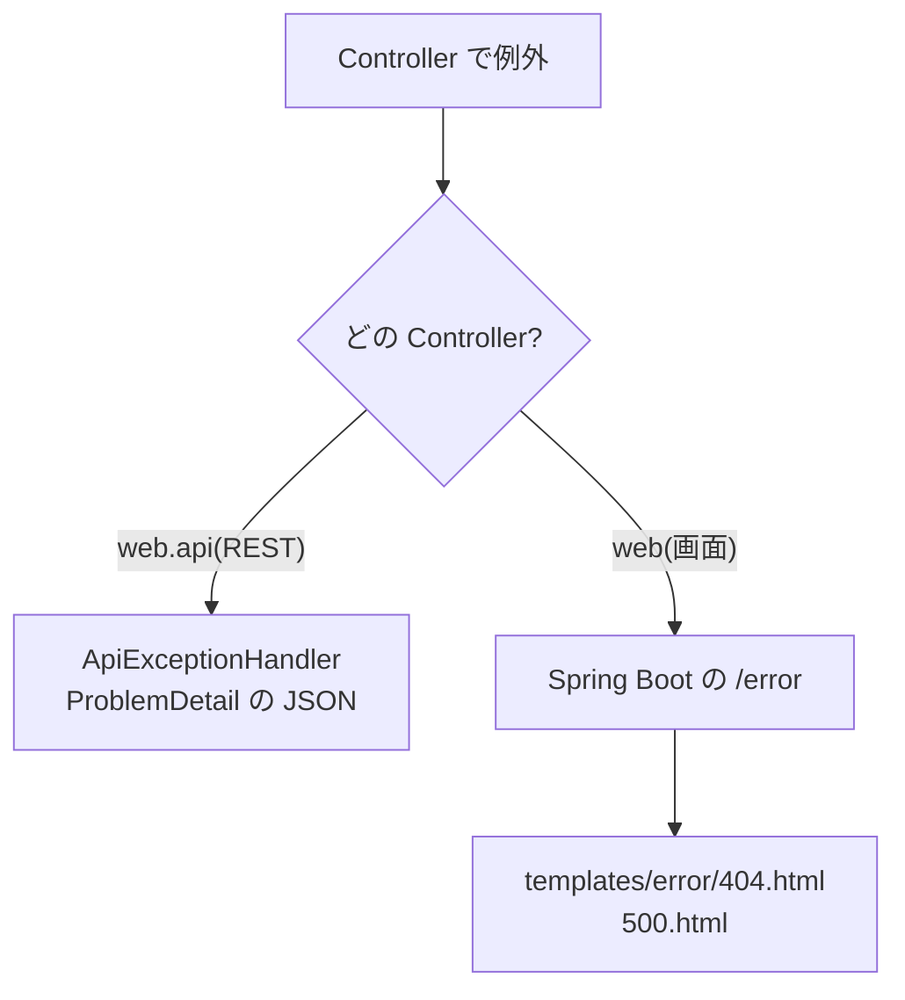
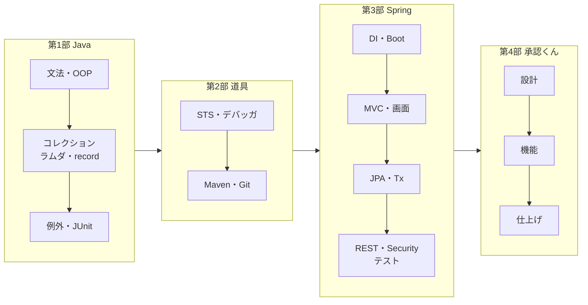

::: haru
先輩、承認くん、全部のテストが緑です! これで完成っすよね?
:::

::: sensei
「動く」と「出せる」は違う。エラーのときに何が見えるか、ログに何が残るか、本番の設定で安全に起動するか。今日はそこを仕上げて、最後に全体をふりかえろう。
:::

## 今回作るもの

```text
src/main/java/com/example/approval
├─ domain/RequestNotFoundException.java(修正)
├─ service/ApprovalService.java(業務ログを追加)
└─ web/api/ApiExceptionHandler.java ★
src/main/resources
├─ templates/error/404.html ★
├─ templates/error/500.html ★
├─ application.yml(共通)
├─ application-dev.yml ★
└─ application-prod.yml ★
```

## エラーの返し先を、画面と API で分ける



人が見る画面には HTML のエラーページを、プログラムが読む API には JSON を返します。

### 画面向け:templates/error に置くだけ

Spring Boot は例外を `/error` に回し、ステータスに合わせて `templates/error/404.html` や `500.html` を探します(なければ `4xx.html` / `5xx.html`、それもなければ白い「Whitelabel Error Page」)。

```html
<!DOCTYPE html>
<html xmlns:th="http://www.thymeleaf.org">
<head><meta charset="UTF-8">
<title>ページが見つかりません</title></head>
<body>
  <h1>お探しの申請は見つかりません</h1>
  <p>URL が間違っているか、申請が存在しません。</p>
  <a th:href="@{/requests}">申請一覧へ戻る</a>
</body>
</html>
```

`500.html` も同じ形で「システムエラーが発生しました」と書き、例外の中身は出しません。Boot も既定で `server.error.include-message=never`・`include-stacktrace=never` です。

画面で存在しない申請を開いたときに 404 にするため、`RequestNotFoundException` に `@ResponseStatus(HttpStatus.NOT_FOUND)` を付けます。domain に Web の注釈が入るのが気になるなら、画面用の `@ControllerAdvice` で 404 にしても構いません。

### API 向け:@RestControllerAdvice で1か所に

前回 Controller の中に書いた `@ExceptionHandler` を、`web.api` 専用の **@RestControllerAdvice** に集めます(Controller からは消します)。

```java
@RestControllerAdvice(basePackageClasses =
        RequestApiController.class)
public class ApiExceptionHandler
        extends ResponseEntityExceptionHandler {
    private static final Logger log =
        LoggerFactory.getLogger(ApiExceptionHandler.class);

    @ExceptionHandler(BusinessRuleException.class)
    public ProblemDetail onRule(BusinessRuleException e) {
        return problem(HttpStatus.CONFLICT,
                "業務ルール違反", e.getMessage());
    }

    @ExceptionHandler(RequestNotFoundException.class)
    public ProblemDetail onNotFound(
            RequestNotFoundException e) {
        return problem(HttpStatus.NOT_FOUND,
                "申請が見つかりません", e.getMessage());
    }

    @ExceptionHandler(Exception.class)
    public ProblemDetail onUnexpected(Exception e) {
        String errorId = UUID.randomUUID().toString()
                .substring(0, 8);
        log.error("想定外のエラー errorId={}", errorId, e);
        ProblemDetail pd = problem(
                HttpStatus.INTERNAL_SERVER_ERROR,
                "システムエラー", "時間をおいて再度お試しください");
        pd.setProperty("errorId", errorId);
        return pd;
    }

    private ProblemDetail problem(HttpStatus status,
            String title, String detail) {
        ProblemDetail pd =
            ProblemDetail.forStatusAndDetail(status, detail);
        pd.setTitle(title);
        return pd;
    }
}
```

硬派ポイントは3つです。

- **basePackageClasses**:範囲を `web.api` に絞る。絞らないと画面の例外まで JSON になる
- **ResponseEntityExceptionHandler を継承**:`Exception` を受けるハンドラだけを書くと、Spring 標準の 400(型変換の失敗)や 405 まで横取りして 500 にしてしまう。継承すると、それらは専用のハンドラが受ける(例外の型が近いほうが選ばれる)
- **500 は中身を返さず、ログに全部**:例外メッセージには SQL や接続先が入りうる。利用者には `errorId` だけ返し、問い合わせが来たらログを `errorId` で検索する

## 業務ログ:誰が・どの申請を・どうしたか

障害調査や監査で「いつ誰が何を承認したか」を追えるよう、状態を変える操作は `ApprovalService` で INFO を1行出します。

```java
log.info("承認 requestId={} actorId={} amount={}",
        request.getId(), actor.getId(),
        request.getAmount());
```

```text
INFO 4242 --- [approval-app] [nio-8080-exec-3]
  c.e.approval.service.ApprovalService
  : 承認 requestId=12 actorId=3 amount=45000
```

- **ID で書く**。氏名・メールアドレス・申請理由の本文は個人情報なので出さない(ID があれば DB で引ける)
- ルール違反は INFO(利用者の操作ミスで、運用者の対応は不要)。想定外の例外だけ ERROR とスタックトレース
- 文字列連結でなく `{}` のプレースホルダで書く

厳密には、このログはコミットの **前** に出ます。コミットが失敗するとログと DB がずれるので、気になるなら `@TransactionalEventListener`(既定でコミット後に動く)で出します。

## プロファイル:dev と prod

共通の `application.yml` に「何も指定しなければ dev」と書き、環境ごとの差分を別ファイルにします。

```yaml
# application.yml
spring:
  application:
    name: approval-app
  profiles:
    default: dev
```

```yaml
# application-prod.yml
spring:
  datasource:
    url: jdbc:h2:file:./data/approval
  h2:
    console:
      enabled: false
  jpa:
    hibernate:
      ddl-auto: validate
  sql:
    init:
      mode: never
logging:
  file:
    name: logs/approval.log
```

`application-dev.yml` には、capstone-setup で書いた H2 のメモリ DB・`ddl-auto`・初期データ・H2 コンソールの設定を移します。

| 設定 | dev | prod |
|---|---|---|
| H2 コンソール | 有効 | **無効** |
| ddl-auto | create-drop など | **validate** |
| ログ | コンソール | **ファイル** |

- **H2 コンソール** はブラウザから DB を直接操作できる画面です。本番で開いていたら、データを丸ごと見られます
- **validate** は起動時にエンティティとテーブルを突き合わせ、合わなければ起動を止めるだけで、DB には一切触りません。`create` は起動のたびにテーブルを作り直す(=データが消える)ので本番では禁止です
- ログファイルは Logback が既定で 10MB ごとに切り替え、7日分残します

## jar を作って java -jar で起動

```text
> .\mvnw package
[INFO] Tests run: 12, Failures: 0, Errors: 0, Skipped: 0
[INFO] Building jar: ...\approval-app-0.0.1-SNAPSHOT.jar
[INFO] BUILD SUCCESS
> java -jar target\approval-app-0.0.1-SNAPSHOT.jar
```

`package` の途中で全テストが流れ、**1本でも赤なら jar はできません**。`-DskipTests` で飛ばすのは「テストが守ってくれる」を自分で外す行為です。

本番の設定は `--spring.profiles.active=prod` を付けて起動します。初回は `Schema-validation: missing table [...]` で止まります。validate が「テーブルがない DB では動かない」と守った結果です。

::: haru
止まったら失敗じゃないんすか?
:::

::: sensei
黙って空のテーブルを作られるより、ずっといい。本番のテーブルは Flyway などで用意する。今回は一度だけ `--spring.jpa.hibernate.ddl-auto=create` を足して作り、外して起動し直そう。
:::

## リリース前チェックリスト

- `mvnw package` が BUILD SUCCESS(全テスト緑)
- 起動ログに `The following 1 profile is active: "prod"`
- prod で `/h2-console` が開けない
- エラー画面・API のエラーに例外メッセージやスタックトレースが出ない
- ログに氏名・メール・パスワードが出ていない
- パスワードや接続情報をファイルに直書きせず、環境変数(`${DB_PASSWORD}`)にしている

## ふりかえり:ここまでの地図



承認くんには全部が入っています。状態遷移は第1部の enum と switch 式、DTO は record、ルール違反は例外、テーブル駆動テストは JUnit。それを STS と Maven で組み立て、Spring で画面・DB・API・権限につなぎました。

## 次に学ぶこと

- **本番 DB と Flyway**:PostgreSQL などに替え、テーブル定義を SQL ファイルでバージョン管理する
- **Docker**:jar と DB をコンテナにして、誰の PC でも同じ手順で起動する
- **CI**:GitHub Actions で push のたびに `mvnw verify` を流し、赤ならマージさせない
- **監視**:Spring Boot Actuator の `/actuator/health` で生死を見る

## よくあるミス

::: warn Exception だけ受けて 400 が 500 に
`ResponseEntityExceptionHandler` を継承せずに `@ExceptionHandler(Exception.class)` を書くと、`?status=submitted` のような入力ミスまで 500 とエラーログになります。
:::

::: warn prod のつもりが dev で起動
`--spring.profile.active=prod`(s が抜けている)はエラーにならず、黙って dev で起動します。起動ログのプロファイル名を必ず見ます。
:::

::: point まとめ
- 画面は `templates/error/*.html`、API は範囲を絞った `@RestControllerAdvice`
- 500 は中身を返さず、`errorId` で利用者とログをつなぐ
- 業務ログは INFO で「誰が・どの申請を・どうしたか」を ID で
- prod は H2 コンソール無効・validate・ファイルログ。jar はテストが緑のときだけできる
:::

::: haru
先輩、Java の「ジャ」の字も怪しかったのに、業務システムを1本作れました……!
:::

::: sensei
仕様を疑い、テストで守り、安全に出す。それができればもう立派な現場の人だ。次は君が誰かに教える番だね。コーヒーでも淹れようか ☕
:::
