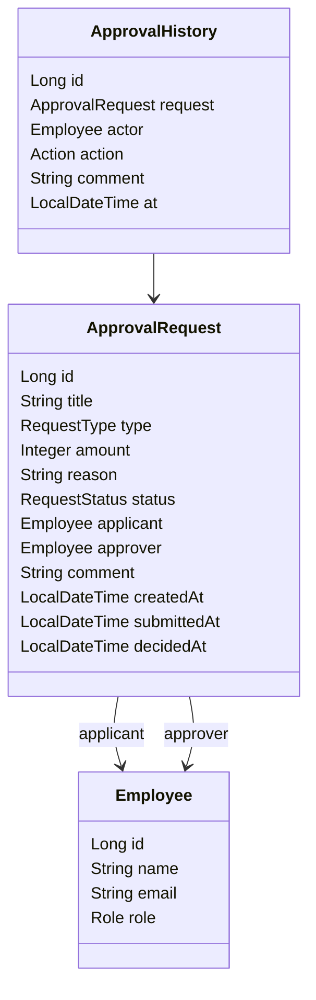
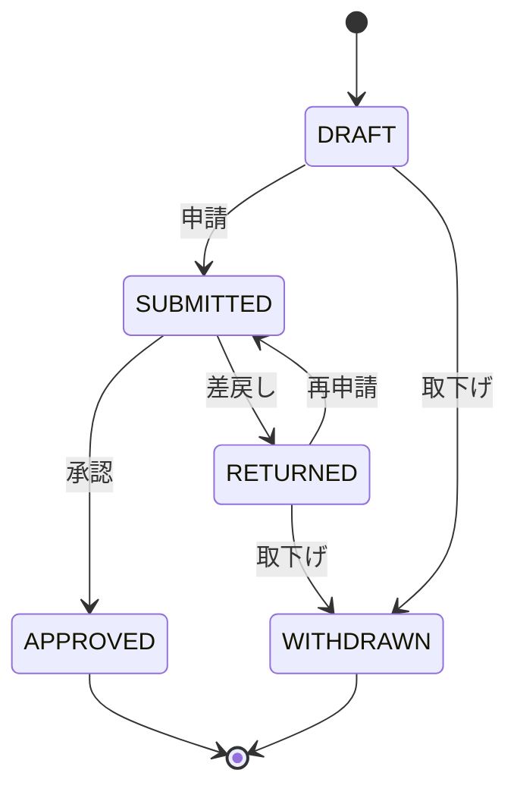

# 第4部 総合演習の設計:申請・承認管理ミニ業務システム

第4部の全レッスンはこの設計を共有する。レッスンをまたいで名前・項目・URL がブレないよう、ここを正とする。

## 作るもの

社内の「申請 → 承認/差戻し」を管理する小さな業務システム(以下 **承認くん**)。
STS で Spring Boot プロジェクトを作り、レッスンごとに機能を足していく。

| 項目 | 値 |
|---|---|
| プロジェクト | STS: File > New > Spring Starter Project。Name `approval-app`、Group `com.example`、Package `com.example.approval`、Java 21、Maven |
| 依存 | Spring Web / Thymeleaf / Validation / Spring Data JPA / H2 Database / Spring Security(capstone-security で追加)/ Spring Boot DevTools |
| パッケージ | `domain`(エンティティ・enum・例外)/ `repository` / `service` / `web`(画面)/ `web.api`(REST)/ `config` |

## ドメイン

- `Role`: `APPLICANT`(申請者)/ `APPROVER`(承認者)/ `ADMIN`(管理者)
- `RequestType`: `EXPENSE`(経費精算)/ `LEAVE`(休暇)/ `PURCHASE`(備品購入)。`amount` は EXPENSE と PURCHASE で必須、LEAVE では null
- `RequestStatus`: `DRAFT`(下書き)/ `SUBMITTED`(申請中)/ `APPROVED`(承認済)/ `RETURNED`(差戻し)/ `WITHDRAWN`(取下げ)
- `Action`: `SUBMIT` / `APPROVE` / `RETURN` / `WITHDRAW`

### 状態遷移

### 業務ルール(演習の採点対象にもなる)

1. 申請・取下げ・再申請ができるのは**申請者本人**だけ
2. 承認・差戻しができるのは `APPROVER` か `ADMIN`。**自分の申請は承認できない**
3. 金額が **100,000円以上** の申請を承認できるのは `ADMIN` だけ
4. **差戻しにはコメント必須**(空白だけは不可)
5. `APPROVED` と `WITHDRAWN` は以後変更できない
6. 状態を変える操作は必ず `ApprovalHistory` を1件残す(同じトランザクションで)
7. ルール違反は `domain` パッケージの `BusinessRuleException`(RuntimeException)で表し、メッセージは日本語

## 画面と URL

| 画面 | メソッド・URL | 誰が |
|---|---|---|
| ログイン | GET /login | 全員 |
| 自分の申請一覧 | GET /requests | 申請者 |
| 新規申請フォーム | GET /requests/new, POST /requests | 申請者 |
| 申請の詳細 | GET /requests/{id} | 関係者 |
| 申請する / 取り下げる | POST /requests/{id}/submit, POST /requests/{id}/withdraw | 申請者 |
| 承認待ち一覧 | GET /approvals | 承認者 |
| 承認 / 差戻し | POST /requests/{id}/approve, POST /requests/{id}/return | 承認者 |
| 検索 | GET /requests/search?status=&type=&keyword=&page=&size= | 承認者 |
| REST API | GET /api/requests?status=, GET /api/requests/{id}, POST /api/requests/{id}/approve | 承認者 |

## レッスンの流れ(第4部)

| レッスン | 作るもの | 画面上の演習(採点) |
|---|---|---|
| capstone-requirements | 要件・画面遷移・ER・状態遷移を書く | `RequestStatus` の遷移可否(素の Java / enum) |
| capstone-setup | プロジェクト作成、エンティティ、Repository、初期データ | エンティティのアノテーションと派生クエリ名(`libraries: [spring, jpa]`) |
| capstone-apply | 申請フォーム(Thymeleaf + Validation)と一覧 | 申請フォームの Controller と入力チェック(MockMvc、`[spring]`) |
| capstone-approve | 承認・差戻しの Service と @Transactional | 業務ルール 1〜6 を守る `ApprovalService`(メモリ上の Repository、素の Java) |
| capstone-search | 検索条件とページング | 検索条件の組み立てとページ計算(`PageRequest` / `Sort`、`[spring, jpa]`) |
| capstone-security | ログインとロール | 「誰が何をできるか」を判定する `AccessPolicy`(素の Java) |
| capstone-api-test | REST API と MockMvc テスト | REST Controller と `@ExceptionHandler`(`[spring]`) |
| capstone-release | 例外画面・ログ・プロファイルで仕上げ | `@RestControllerAdvice` のエラー応答(`[spring]`) |

演習は default package・1ファイルの制約があるので、STS で作る本物のコード(パッケージあり)を
「採点用に1ファイルへまとめた縮小版」として出題する。lesson.md では STS 側の本物の配置(パッケージ・ファイル名)も必ず示す。
