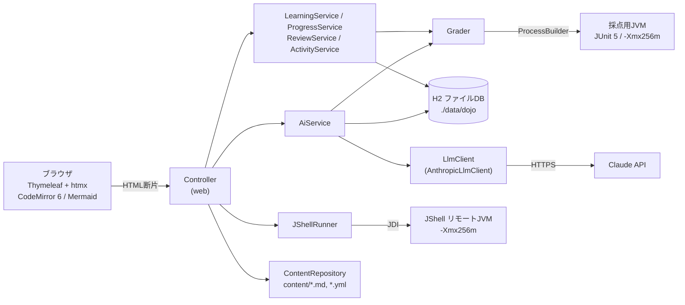

# Java道場 — 全体設計とフェーズ計画

Java / STS / Spring Boot をゼロから体系的に学ぶための、**ローカル専用の個人用学習Webアプリ**。
1レッスンの中で **読む → 動かす → 書く → AIに見てもらう → 復習** が回ることを最重要とする。

---

## 1. 方針

| 項目 | 決めたこと |
|---|---|
| 利用形態 | 自分の Windows PC で起動し、ブラウザで `http://127.0.0.1:8080` を開く。`server.address=127.0.0.1` で外部から接続させない。スマホは「Codespaces」か「LANモード(合言葉つき)」で使う |
| 技術 | Java 21 / Spring Boot 3.5 / Maven Wrapper / Thymeleaf + htmx(SPAなし)/ H2(ファイル)+ Spring Data JPA / CodeMirror 6(CDN) |
| 教材 | `content/` 配下の Markdown + YAML。**実行時に生成しない**。書式は [CONTENT_FORMAT.md](CONTENT_FORMAT.md) |
| AI | Claude API(公式 Java SDK `com.anthropic:anthropic-java`)。APIキーは環境変数 `ANTHROPIC_API_KEY`。未設定でも AI 以外は全部動く |
| 語り口 | モカ先輩 ☕(現場15年)と新人ハル 🐣 の掛け合い。軽く読めるが内容は硬派 |
| やらないこと | ログイン・マルチユーザー・外部公開用デプロイ・SPA化(LANモードの合言葉は「PC以外から勝手にコードを実行させない」ための最低限の入口) |

---

## 2. アーキテクチャ

### パッケージ

| パッケージ | 役割 |
|---|---|
| `config` | `DojoProperties`(`dojo.*` 設定)、`Clock` |
| `content` | 教材の読み込み(`ContentRepository`)、Markdown 描画(`MarkdownRenderer`、`::: sensei` などの拡張記法)、モデル(`Part`/`Chapter`/`Lesson`/`ExerciseDef`) |
| `exec` | コード実行(`JShellRunner`)と採点(`Grader`)、同時実行数の制御(`ExecutionGate`) |
| `progress` | エンティティとリポジトリ、学習の記録(`LearningService`)、集計(`ProgressService`)、間隔反復(`ReviewService`)、学習日(`ActivityService`) |
| `ai` | Claude API 呼び出しの集約(`AiService`)、プロンプト(`PromptLibrary` → `src/main/resources/prompts/*.md`)、`LlmClient` インターフェースと SDK 実装 |
| `web` | 画面と htmx エンドポイント |

### コード実行と採点

- **サンプル・プレイグラウンド**: JShell API(`jdk.jshell`)。JShell はコードを別JVM(リモートエージェント)で実行するので、
  無限ループでも本体は固まらない。入力をスニペットに分割して順に `eval` し、式の値・標準出力・コンパイルエラー(日本語・行番号つき)・例外を返す。
  `main` を持つクラスだけを宣言したコードは `main` を自動で呼ぶ。10秒でタイムアウト → `stop()` して JShell ごと破棄。
- **演習の採点**: 一時ディレクトリに「提出コード + 採点テスト + 採点ランナー」を書き出し、`javax.tools.JavaCompiler` でコンパイル
  (エラーは日本語メッセージ)。別JVMプロセス(`-Xmx256m -XX:+UseSerialGC`)で JUnit Platform Launcher を動かし、
  テストごとの合否と失敗理由(期待値と実際の値)をファイル経由で受け取る。10秒を超えたらプロセスツリーごと強制終了。
- 出力は上限つきバッファ(既定 20,000 文字)。子JVMの同時実行数は既定 2(`dojo.exec.max-concurrent`)。
- **追加ライブラリ**: 演習やサンプルに `libraries: [spring]`(+ `thymeleaf` / `jpa`)を書くと、アプリ自身のクラスパスから Spring・spring-test(MockMvc)・
  Jackson・Bean Validation などの jar を探して、採点JVMや JShell に渡す(`LibraryClasspath`)。Spring の演習はタイムアウト最低20秒。
- JShell では jshell コマンドと同じ標準 import を入れ、行頭がドットのメソッドチェーンもつないで実行する。

### Claude API を使う機能

| 機能 | モデル(既定) | 何を渡すか |
|---|---|---|
| AIチューター | `claude-sonnet-5-5` | レッスン本文 + 過去の会話 + いまのコード + 質問。答えを丸ごと教えず考え方を誘導 |
| 段階ヒント | `claude-haiku-5-5` | 問題文 + いまのコード + これまでのヒント。方向性 → 手がかり → ほぼ答え の3段階 |
| コードレビュー | `claude-opus-5-5` | 提出コード + 採点結果 + 模範解答(参考)。正解でも「より良い書き方」「現場ならこう書く」 |
| エラー翻訳 | `claude-sonnet-5-5` | コード + コンパイルエラー/例外/テスト失敗/タイムアウト |
| 類題生成 | `claude-haiku-5-5` | レッスン本文 + 既存演習の一覧。**模範解答が採点テストに合格し、雛形が落ちることを Grader で検証**してから保存。失敗したら理由を返して1回作り直す |

- モデル名は `application.yml` の `dojo.ai.models.*` で変更できる。
- **プロンプトキャッシュ**: `system[0]` = 共通の前置き + レッスン教材(`cache_control` 付き、同じレッスンなら毎回同じバイト列)、
  `system[1]` = 機能ごとの指示(`prompts/*.md`)、`messages` = 毎回変わるもの。同じレッスンで何度質問しても教材部分はキャッシュから読まれる。
- Sonnet 系では拒否(refusal)時のサーバー側フォールバック(`fallbacks: "default"`)を有効化(`dojo.ai.refusal-fallback` で無効化可)。
- テストでは `LlmClient` を Mockito のモックに差し替える(実APIに通信しない)。

### データモデル(H2)

| エンティティ | 内容 |
|---|---|
| `LessonProgress` | レッスンの足あと(初回訪問・読了・サンプル実行) |
| `Submission` | 演習の提出(コード・採点結果JSON・AIレビュー・エラー翻訳) |
| `QuizAttempt` | 確認クイズの解答 |
| `ChecklistCheck` | STS 手順などの「やった」チェック |
| `ReviewItem` | 復習キュー(クイズ1問 or 演習1問。段階・次回日・つまずき回数) |
| `StudyDay` | 学習した日(連続学習日数) |
| `ChatMessage` / `HintRecord` | チューターの会話・段階ヒント |
| `GeneratedExercise` | AI が作った類題 |

### 学習管理のルール

- **レッスン完了** = 全演習に合格 + クイズ最高点が 8 割以上 + チェックリスト全部。
- **復習キュー(間隔反復)**: クイズ・演習に初めて取り組むと 1日後に出題。復習で正解するたびに 3日後 → 7日後 → 14日後、
  14日後にも正解で卒業。間違えたら(レッスン画面で間違えた場合も)1日後からやり直し。
- **苦手レッスン** = 直近クイズの誤答率 ×3 + 演習の不合格回数 ×0.3(最大6回)+ つまずき回数 ×0.5 が 1.0 以上のもの。
  ダッシュボードから類題を作れる。
- **連続学習日数** = 今日(まだなら昨日)から遡って、学習記録のある日が何日続いているか。

---

## 3. カリキュラム

全50レッスン完成。各レッスンに解説・クイズ5問・コラム、演習(第1部・第3部は1〜3問、STS中心のレッスンは0〜3問)、
第2部以降は「STSでやってみよう」とチェックリストがある。第4部の共通設計は [CAPSTONE.md](CAPSTONE.md)。

### 第1部 Java基礎

- 第1章 はじめの一歩
  - [x] 環境とHello World(`java-hello`)… STS手順・チェックリスト付き
  - [x] 変数と型(`java-variables`)
  - [x] 演算子(`java-operators`)
- 第2章 制御構文と配列
  - [x] 条件分岐(`java-if`)
  - [x] ループ(`java-loops`)
  - [x] 配列(`java-arrays`)
- 第3章 メソッドと文字列
  - [x] メソッド(`java-methods`)
  - [x] 文字列(`java-strings`)
- 第4章 オブジェクト指向
  - [x] クラスとオブジェクト(`java-classes`)
  - [x] カプセル化(`java-encapsulation`)
  - [x] 継承(`java-inheritance`)
  - [x] ポリモーフィズム(`java-polymorphism`)
  - [x] 抽象クラスとインターフェース(`java-abstract-interface`)
- 第5章 例外処理
  - [x] 例外処理(`java-exceptions`)
- 第6章 コレクションとジェネリクス
  - [x] コレクション(`java-collections`)
  - [x] ジェネリクス(`java-generics`)
- 第7章 モダンJava
  - [x] ラムダとStream(`java-lambda-stream`)
  - [x] Optional(`java-optional`)
  - [x] recordとenum(`java-record-enum`)
  - [x] 日付API(`java-datetime`)
- 第8章 入出力とテスト
  - [x] ファイルIO(`java-file-io`)
  - [x] JUnit入門(`java-junit`)

### 第2部 開発ツール(全レッスンに「STSでやってみよう」+ チェックリスト)

- 第1章 STSの基本
  - [x] STSの導入と画面構成(`sts-setup`)
  - [x] プロジェクトの作成とインポート(`sts-projects`)
- 第2章 デバッグとリファクタリング
  - [x] デバッガ(ブレークポイント・ステップ実行・変数監視)(`sts-debugger`)
  - [x] ショートカットとリファクタリング機能(`sts-shortcuts`)
- 第3章 ビルドとバージョン管理
  - [x] Maven(pom.xml・依存関係・ライフサイクル)(`tools-maven`)
  - [x] Git連携(`tools-git`)

### 第3部 Spring

- 第1章 Springの核
  - [x] DIとIoCコンテナ(`spring-di`)
  - [x] Spring Bootの起動の仕組み(`spring-boot-startup`)
- 第2章 Webの基本
  - [x] Controllerとルーティング(`spring-controller`)
  - [x] Thymeleaf(`spring-thymeleaf`)
  - [x] フォームとバリデーション(`spring-forms`)
- 第3章 設計とデータアクセス
  - [x] Controller・Service・Repositoryの層分け(`spring-layers`)
  - [x] Spring Data JPA(`spring-data-jpa`)
  - [x] トランザクション(`spring-transaction`)
- 第4章 APIと例外
  - [x] REST API(`spring-rest`)
  - [x] 例外ハンドリング(`spring-exception-handling`)
- 第5章 設定とログ
  - [x] 設定ファイルとプロファイル(`spring-config`)
  - [x] ログ(`spring-logging`)
- 第6章 セキュリティとテスト
  - [x] Spring Security入門(`spring-security`)
  - [x] MockMvcによるテスト(`spring-mockmvc`)

### 第4部 総合演習:申請・承認管理のミニ業務システム

- 第1章 設計と土台
  - [x] 要件整理と画面・テーブル設計(`capstone-requirements`)
  - [x] プロジェクト作成とエンティティ(`capstone-setup`)
- 第2章 業務機能の実装
  - [x] 申請の登録と一覧(`capstone-apply`)
  - [x] 承認・差戻しフロー(`capstone-approve`)
  - [x] 検索とページング(`capstone-search`)
- 第3章 仕上げ
  - [x] ログインと権限(`capstone-security`)
  - [x] REST APIとテスト(`capstone-api-test`)
  - [x] 例外・ログ・プロファイルで仕上げ(`capstone-release`)

---

## 4. フェーズ計画

### フェーズ1 ✅ アプリの土台と最初の6レッスン

- [x] 全体設計・カリキュラム一覧・フェーズ計画(このファイル)
- [x] ダッシュボード / レッスン画面 / 復習 / 提出履歴 / プレイグラウンド
- [x] コード実行(JShell)と採点(別JVM + JUnit、タイムアウト・メモリ上限)
- [x] 進捗・連続学習日数・苦手レッスン・復習キュー(1→3→7→14日)
- [x] AI機能:チューター / 段階ヒント / コードレビュー / エラー翻訳 / 類題生成(検証つき)
- [x] 第1部の最初の6レッスン、自動テスト(全演習の模範解答が合格・雛形が不合格、全サンプルが動く)

### フェーズ2 ✅ スマホ対応と全カリキュラム

- [x] スマホ向けUI(下部メニュー、記号キー付きエディタ、自動大文字化オフ、下から出るAIチューター)
- [x] GitHub Codespaces 用の devcontainer(PCなしでスマホから使う)
- [x] LANモード(同じWi-Fiのスマホから。PC以外は合言葉が必要)
- [x] 採点・JShell で Spring / MockMvc / Thymeleaf / JPA を使えるように(`libraries`)
- [x] 第1部の残り16レッスン、第2部 6レッスン、第3部 14レッスン、第4部 8レッスン(全50レッスン)
- [x] スマホ版(`m/`、GitHub Pages で配信): PC も Wi-Fi も無くても読む・クイズ・復習・演習の自己チェック。
      Service Worker で全レッスンを端末に保存、記録は端末の localStorage、AI は端末に保存した APIキーでブラウザから直接呼ぶ

### これから(改善候補)

- [ ] 実際の Claude API での動作確認とプロンプトの調整(このリポジトリのテストはモックのみ)
- [ ] Windows + STS 実機での確認(第2部の手順・メニュー表記、LANモードのファイアウォール)
- [ ] Codespaces を実際にスマホから起動しての確認
- [ ] AIチューターの応答ストリーミング(SSE)
- [ ] 復習キューの「今日はここまで」上限設定
- [ ] 学習データのエクスポート(JSON)
- [ ] ダークテーマ
- [ ] 第4部の完成版コード(approval-app)を `content/04-capstone/reference/` に置き、差分で答え合わせできるようにする

## 5. 教材を追加する手順

1. `content/<部>/<章>/<レッスン>/lesson.yml` の `status` を `ready` にし、[CONTENT_FORMAT.md](CONTENT_FORMAT.md) に沿って中身を書く
2. `lesson.md` に解説、`exercises/exN/` に演習(`exercise.yml` / `starter.java` / `solution.java` / `test.java`)
3. 演習は `scripts/verify-exercise.sh <演習ディレクトリ>`(Git Bash など)で単体確認できる
4. アプリのフッターの「教材を再読み込み」で反映(再起動不要)。スマホ版は `./mvnw -q compile exec:java` で `m/` を作り直してコミットする
5. `./mvnw test` で全演習・全サンプルを自動検証(`CurriculumTest`)。レッスンを増やしたら `CurriculumTest#curriculumShape` の件数も更新する
